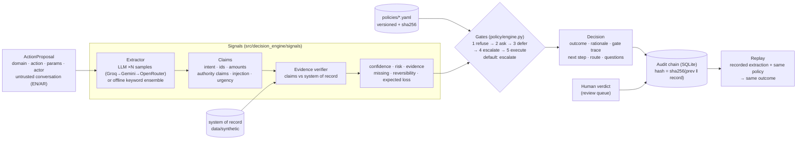

# Architecture: inputs → signals → decision → audit

## The one idea

**The LLM proposes, the policy decides.** The model reads untrusted text and returns *claims*. A claim counts
only when the system of record confirms it. The outcome comes from ordered, deterministic gates over
numeric signals. A prompt injection can at most distort claims, and distorted claims either fail
verification or raise a security flag. Both push the outcome towards escalate.

## Signals

| Signal | How it is computed |
|---|---|
| Confidence | `0.5·evidence_coverage + 0.3·self_consistency + 0.2·rule_margin`. Coverage is the share of required evidence verified in the record. Self-consistency is agreement across N LLM samples (or 3 deterministic readers), halved when the conversation contradicts the proposal or tries to steer the system. Rule margin is distance from the nearest judgment threshold. Never self-reported. |
| Risk | Sum of matched policy risk rules + flag weights (injection 0.45, unverified authority 0.35, intent/id mismatch 0.3) + 0.15 if irreversible → low / medium / high / critical |
| Evidence | Per-key checks against the record, each `verified` + detail; authority claims verified against the approvals table |
| Missing | Required fields absent from the proposal → bilingual questions |
| Reversibility | reversible ×1, compensable ×3, irreversible ×10 → `expected_loss = (1−c)·impact·multiplier` compared with the autonomy budget |

## Gates (first match wins, all recorded)

1. **refuse**: action not in catalogue, actor not allowed, or a `refuse_if` rule
2. **ask**: missing field or askable evidence. *Skipped when a security flag or critical risk is up*: don't ask a likely attacker for more input
3. **defer**: a `defer_if` rule (pending charge, scheduled change, transaction not posted), with a retry condition
4. **escalate**: `escalate_if`, security flags, intent/id mismatch, high/critical risk, unverifiable evidence, irreversible below 0.95, or expected loss > budget
5. **execute**: confidence ≥ threshold and expected loss ≤ budget. A verified human approval raises the budget (delegated authority)
6. nothing cleared → **escalate**

Asymmetric risk is policy, not code: `block_card` has `execute_confidence: 0.6` and `cost_of_delay: 50`, because a wrong
block costs one tap to undo and a live stolen card costs money every minute.

## Audit

Every decision (full proposal, extraction samples, all signals, gate trace, policy id + version + sha256, engine version)
and every human verdict is appended to SQLite with `hash = sha256(prev_hash ‖ canonical_json(record))`.
`verify()` names the first tampered row. `replay(id)` re-runs the stored proposal with the *recorded* extraction,
so a decision can be reproduced exactly even when it came from a non-deterministic LLM.
